# 💬 Awesome Team Messaging & Collaboration 🚀

> ⚡ **A curated directory of top-tier Team Messaging, Instant Chat, and Enterprise Collaboration platforms** — featuring commercial SaaS suites (Slack, Microsoft Teams, Cisco Webex, Discord) and self-hosted, federated, and AI-native open-source solutions (Rocket.Chat, Mattermost, Zulip, Element, Matrix, SimpleX Chat, Buzz).  
> 🌟 *Star this repository to bookmark and support ongoing updates!* 🌟

  
  
  
  
  
  
  

---

## 📋 Table of Contents

- [📈 Sector Overview & Market Dynamics](#-sector-overview--market-dynamics)
- [🟦 SaaS / Hosted Platforms](#-saas--hosted-platforms)
- [🟩 Open-Source Software](#-open-source-software)
  - [🚀 Rocket.Chat](#-rocketchat)
  - [💻 Mattermost](#-mattermost)
  - [📥 Chatwoot](#-chatwoot)
  - [⚡ Buzz (Block)](#-buzz-block)
  - [🧵 Zulip](#-zulip)
  - [🛡️ SimpleX Chat](#️-simplex-chat)
  - [🌐 Element (Matrix)](#-element-matrix)
  - [📡 Tinode](#-tinode)
  - [🏛️ Matrix Synapse](#️-matrix-synapse)
  - [🎮 Spacebar](#-spacebar)
  - [📝 Colanode](#-colanode)
  - [✨ Cinny](#-cinny)
  - [🧩 Tailchat](#-tailchat)
  - [🦊 Stoat (Revolt)](#-stoat-revolt)
  - [🔐 Wire Server](#-wire-server)
- [📊 Comparison at a Glance](#-comparison-at-a-glance)
- [💡 How to Choose the Right Tool](#-how-to-choose-the-right-tool)
- [⭐ Star History](#-star-history)
- [🤝 Contributing](#-contributing)
- [💖 Support & Sponsorship](#-support--sponsorship)
- [📄 License](#-license)

---

## 📈 Sector Overview & Market Dynamics

The global **team collaboration software** and **enterprise messaging market** is valued at approximately **$21B to $40B+**, advancing at a compound annual growth rate (**CAGR of 9.5% to 12%**). 

### 🌐 Key Industry Dynamics
* 🏛️ **Concentrated Enterprise Oligopoly at the Top:** The upper crust of enterprise messaging is heavily dominated by mega-ecosystem vendors—**Microsoft 365 (Teams)**, **Google Workspace (Google Chat)**, and **Salesforce (Slack)**. These vendors leverage established workplace software bundles and identity systems to create high switching costs and sticky enterprise rollouts.
* 🧩 **Extensive Mid-Market & Open-Source Fragmentation:** Below the top tier, the sector is markedly fragmented. Hundreds of independent alternatives and open-source frameworks thrive by serving specialized architectural demands: **asynchronous topic-based discussions** (Zulip), **strict air-gapped on-premises security** (Mattermost, Rocket.Chat), **zero-metadata cryptographic anonymity** (SimpleX Chat), **cross-organizational open federation** (Matrix/Element), and **AI-agent collaboration relays** (Buzz).
* 🤖 **AI-Native Agents & Convergence:** Modern workplace messaging has shifted from simple chat channels into automated operational hubs where humans and autonomous LLM agents (Claude Code, Goose, OpenAI assistants) interact as peers through cryptographically verifiable events.

---

## 🟦 SaaS / Hosted Platforms

Commercial, cloud-hosted Team Messaging and Collaboration platforms sorted by company valuation/market capitalization (descending).

| 🏢 Platform | 💰 Company Valuation / Market Cap | 🏷️ Starting Tier Pricing | 🎁 Free Tier / Trial Limits | 🔍 Key Focus & Architecture Description |
|:---|:---|:---|:---|:---|
| **Microsoft Teams** | ~$3.87 Trillion - $3.94 Trillion *(Microsoft - Public: MSFT)* | **$4.00 / user / month** (billed annually for Microsoft Teams Essentials) | **Free Forever Plan:** Up to 100 participants per meeting, 60-minute group meeting cap, and 5 GB cloud storage per organization. | Unified enterprise collaboration hub bundled within Microsoft 365, featuring persistent channels, meetings, calling, and Office app integration. |
| **Google Chat** | ~$3.48 Trillion - $3.50 Trillion *(Alphabet - Public: GOOGL)* | **$7.00 / user / month** (billed annually for Google Workspace Business Starter) | **Free Forever (Personal @gmail.com):** 1:1 and group spaces with 15 GB shared Google account storage. **Workspace Business:** 14-day free trial with full Business tier features. | Web and mobile messaging tightly coupled into Google Workspace, Gmail, and Google Meet with Spaces supporting up to 500k members. |
| **Cisco Webex App** | ~$369 Billion - $383 Billion *(Cisco Systems - Public: CSCO)* | **$12.00 / user / month** (billed annually for Webex Meet Plan) | **Free Forever Plan:** 100 participants per meeting, 40-minute group meeting limit, unlimited 1:1 meetings, unlimited messaging, and digital whiteboarding. | Enterprise-grade collaboration suite combining persistent chat channels, secure enterprise calling, webinars, and HD video meetings. |
| **Slack** | ~$177 Billion - $183 Billion *(Salesforce - Public: CRM)* | **$7.25 / user / month** (billed annually for Slack Pro) | **Free Forever Plan:** 90 days of searchable message/file history (1-year rolling deletion), 5 GB workspace storage, 10 app integrations, and 1:1 audio/video huddles. | Industry-standard channel-based messaging workspace with rich ecosystem integrations, developer webhooks, and team communication. |
| **Zoho Cliq** | ~$8.0 Billion - $12.5 Billion *(Zoho Corp - Private / Bootstrapped)* | **$16.20 / month** flat fee (up to 25 users on Standard; or $2.00/user/month for Professional, min 10 users) | **Free Forever Plan:** Unlimited users, 10,000 searchable messages organization-wide, 100 GB file storage, 100 members per channel, and 5-min audio/video recordings. | Lightweight team communication platform deeply integrated with Zoho CRM, Projects, and Desk, optimized for SME workplace collaboration. |
| **Discord** | ~$8.0 Billion - $8.5 Billion *(Discord Inc. - Private)* | **$2.99 / user / month** (Nitro Basic) | **Free Forever Plan:** Unlimited message history, 10 MB file upload limit, up to 100 servers, 2,000 characters per message, and standard voice/video channels. | Real-time community and team communication platform featuring voice rooms, low-latency streaming channels, and rich bot extensibility. |

---

## 🟩 Open-Source Software

Self-hosted, community-driven Team Messaging and Collaboration tools, sorted by GitHub stargazers count (descending).

### 🚀 Rocket.Chat 
- **Stack:** 💻 TypeScript / Node.js / MongoDB
- **License:** ⚖️ MIT (Community) / Open Core
- **Repository:** 🔗 [RocketChat/Rocket.Chat](https://github.com/RocketChat/Rocket.Chat)
- **Overview:** Rocket.Chat is an enterprise-grade open-source communication platform engineered for organizations with rigorous compliance and security standards. It supports air-gapped deployments, end-to-end encryption (E2EE), omnichannel customer service routing, Matrix federation, and role-based access control.  
- **⚠️ Critical consideration:** The Community edition limits push notifications via the Rocket.Chat Cloud gateway to 10,000 per month; larger scale requires enterprise licensing or self-compiled mobile binaries.  
- **🎯 Best for:** Regulated industries, healthcare, government, and organizations needing self-hosted compliance and air-gapped messaging.

---

### 💻 Mattermost 
- **Stack:** 💻 Go / React / PostgreSQL
- **License:** ⚖️ MIT (Team Edition) / Open Core
- **Repository:** 🔗 [mattermost/mattermost](https://github.com/mattermost/mattermost)
- **Overview:** Mattermost is the leading self-hosted Slack alternative tailored for engineering and technical teams. Built as an efficient single Go binary running against PostgreSQL, it provides persistent channels, threaded discussions, slash commands, bot webhooks, and integrated incident playbooks with minimal infrastructure overhead.  
- **⚠️ Critical consideration:** Mobile push notifications on the free tier route through the Test Push Notification Service (TPNS), while production-grade HPNS requires paid subscriptions or enterprise setups.  
- **🎯 Best for:** Technical and software development teams wanting an agile, Slack-compatible workspace with full data sovereignty.

---

### 📥 Chatwoot 
- **Stack:** 💻 Ruby on Rails / Vue.js / PostgreSQL / Redis
- **License:** ⚖️ AGPL-3.0
- **Repository:** 🔗 [chatwoot/chatwoot](https://github.com/chatwoot/chatwoot)
- **Overview:** Chatwoot is an open-source customer communication and team collaboration platform. It provides shared team inboxes, live web chat, omnichannel messaging (integrating WhatsApp, Email, Telegram, and Facebook), internal collaborator notes, and canned responses to unify customer and internal team communications.  
- **🎯 Best for:** Support, marketing, and cross-functional teams that need to collaborate internally on incoming external customer channels.

---

### ⚡ Buzz (Block) 
- **Stack:** 💻 Rust / Nostr Protocol / PostgreSQL / Redis
- **License:** ⚖️ Apache 2.0
- **Repository:** 🔗 [block/buzz](https://github.com/block/buzz)
- **Overview:** Buzz is an open-source collaboration platform developed by Block that unifies real-time team chat, Git repositories, and first-class AI agent workflows on top of the Nostr protocol. Every message, reaction, code review, and AI agent execution is cryptographically signed, creating an immutable audit trail for human and autonomous AI agent collaboration.  
- **🎯 Best for:** AI-forward engineering teams wanting cryptographic auditability and unified chat-plus-code workflows with autonomous agents.

---

### 🧵 Zulip 
- **Stack:** 💻 Python / Django / PostgreSQL
- **License:** ⚖️ Apache 2.0
- **Repository:** 🔗 [zulip/zulip](https://github.com/zulip/zulip)
- **Overview:** Zulip pairs real-time chat with a unique stream-and-topic threading structure reminiscent of email threads. Conversations are segmented into narrow topics within channels, allowing distributed teams in different time zones to process conversations asynchronously without losing context or drowning in chat streams.  
- **🎯 Best for:** Distributed, asynchronous-first remote teams and open-source communities that prioritize organized, long-running context over noisy chat streams.

---

### 🛡️ SimpleX Chat 
- **Stack:** 💻 Haskell / Kotlin / Swift
- **License:** ⚖️ AGPL-3.0
- **Repository:** 🔗 [simplex-chat/simplex-chat](https://github.com/simplex-chat/simplex-chat)
- **Overview:** SimpleX Chat is a privacy-first, decentralized messaging network built entirely without user identifiers (no user IDs, phone numbers, usernames, or public keys exposed to network servers). It supports end-to-end encrypted direct messages, self-hosted chat servers, hidden group profiles, and audio/video calling.  
- **🎯 Best for:** Teams and collectives requiring extreme anonymity, surveillance resistance, and zero-metadata messaging.

---

### 🌐 Element (Matrix) 
- **Stack:** 💻 TypeScript / React / Matrix Protocol
- **License:** ⚖️ AGPL-3.0
- **Repository:** 🔗 [element-hq/element-web](https://github.com/element-hq/element-web)
- **Overview:** Element is the flagship client for the decentralized Matrix communication protocol. It features native end-to-end encryption, cross-signing identity verification, cross-organization server federation, and voice/video rooms powered by WebRTC, letting users communicate seamlessly across different independently hosted homeservers.  
- **🎯 Best for:** Federated collaboration between independent companies, academic institutions, and defense/public-sector consortia.

---

### 📡 Tinode 
- **Stack:** 💻 Go / gRPC / MySQL / PostgreSQL / RethinkDB
- **License:** ⚖️ GPL-3.0
- **Repository:** 🔗 [tinode/chat](https://github.com/tinode/chat)
- **Overview:** Tinode is a lightweight, high-performance instant messaging server written in Go. Designed as an open-source alternative to WhatsApp and Telegram, it supports real-time text, voice/video calling, push notifications, and customizable bot integrations over gRPC and WebSockets with very low resource usage.  
- **🎯 Best for:** Developers looking to embed custom instant messaging within applications or deploy low-resource self-hosted chat.

---

### 🏛️ Matrix Synapse 
- **Stack:** 💻 Python / Twisted / Rust / PostgreSQL
- **License:** ⚖️ AGPL-3.0
- **Repository:** 🔗 [matrix-org/synapse](https://github.com/matrix-org/synapse)
- **Overview:** Synapse is the reference Matrix homeserver implementation, handling routing, distributed state resolution, decentralized room storage, and federated message synchronization across the global Matrix federation network. It pairs with clients like Element, Cinny, and FluffyChat.  
- **🎯 Best for:** System administrators and DevOps deploying the backbone infrastructure for a federated, self-hosted Matrix ecosystem.

---

### 🎮 Spacebar 
- **Stack:** 💻 TypeScript / Node.js / Express
- **License:** ⚖️ AGPL-3.0
- **Repository:** 🔗 [spacebarchat/spacebarchat](https://github.com/spacebarchat/spacebarchat)
- **Overview:** Spacebar is an open-source, self-hostable Discord-compatible communications platform. It implements Discord-compatible API endpoints and gateway protocol layers, enabling existing Discord bots, clients, and integrations to connect to a private, user-controlled server without code modification.  
- **🎯 Best for:** Communities and developer teams desiring a Discord-like experience with complete server control and bot compatibility.

---

### 📝 Colanode 
- **Stack:** 💻 TypeScript / Rust / CRDTs (Yjs) / SQLite
- **License:** ⚖️ AGPL-3.0
- **Repository:** 🔗 [colanode/colanode](https://github.com/colanode/colanode)
- **Overview:** Colanode is an open-source, local-first collaboration workspace that marries Slack-style team chat channels with Notion-style rich-text documents and databases. Powered by Conflict-free Replicated Data Types (CRDTs), it guarantees real-time offline capability and instant synchronization.  
- **🎯 Best for:** Teams looking for a unified hybrid of real-time messaging, asynchronous knowledge base documentation, and local-first data resilience.

---

### ✨ Cinny 
- **Stack:** 💻 JavaScript / React / Matrix SDK
- **License:** ⚖️ MIT / AGPL-3.0
- **Repository:** 🔗 [cinnyapp/cinny](https://github.com/cinnyapp/cinny)
- **Overview:** Cinny is an ultra-clean, lightweight web and desktop client for Matrix. Focusing on speed, elegant design, and simplicity, it presents an intuitive Slack/Discord-style interface on top of Matrix homeservers without the complexity often found in enterprise clients.  
- **🎯 Best for:** Teams and individual users on Matrix wanting an uncluttered, fast, and modern desktop/browser chat experience.

---

### 🧩 Tailchat 
- **Stack:** 💻 TypeScript / React / Moleculer / MongoDB
- **License:** ⚖️ Apache 2.0
- **Repository:** 🔗 [msgbyte/tailchat](https://github.com/msgbyte/tailchat)
- **Overview:** Tailchat is an open-source, plugin-extensible digital workspace and instant messaging system. Built around a microservices backend architecture, it provides servers, channels, voice chat, and an ecosystem of community plugins for task management, rich embeds, and bot automation.  
- **🎯 Best for:** Communities and organizations seeking a customizable, modular Slack/Discord alternative with microservices scalability.

---

### 🦊 Stoat (formerly Revolt) 
- **Stack:** 💻 Rust / TypeScript / Actix / MongoDB
- **License:** ⚖️ AGPL-3.0
- **Repository:** 🔗 [stoatchat/stoatchat](https://github.com/stoatchat/stoatchat)
- **Overview:** Stoat (formerly Revolt) is an open-source Discord alternative designed for privacy-conscious communities and teams. It supports servers, nested text/voice channels, customizable roles, bots, and user badges with a responsive web and desktop frontend.  
- **🎯 Best for:** Gaming groups, tech communities, and distributed teams needing community server dynamics with self-hosted data ownership.

---

### 🔐 Wire Server 
- **Stack:** 💻 Haskell / Kubernetes / Cassandra / Elasticsearch
- **License:** ⚖️ AGPL-3.0
- **Repository:** 🔗 [wireapp/wire-server](https://github.com/wireapp/wire-server)
- **Overview:** Wire is an enterprise secure collaboration platform emphasizing audited end-to-end encryption based on the Proteus protocol. It delivers messaging, conference calling, and file sharing with strict European privacy compliance (GDPR) and turnkey Kubernetes deployment configurations.  
- **🎯 Best for:** Enterprises, security agencies, and legal/financial firms requiring end-to-end encrypted team communication with compliance certification.

---

## 📊 Comparison at a Glance

| 🛠️ Software | 📦 Model | ⚖️ License / Host | 💻 Primary Stack | 🌐 Federation | 🔒 E2EE | 🤖 AI Native | 🎯 Key Differentiator |
|:---|:---|:---|:---|:---|:---|:---|:---|
| **Microsoft Teams** | SaaS | Commercial | Cloud | ❌ | Optional (1:1) | ✅ Copilot | Deep Microsoft 365 enterprise office bundle |
| **Google Chat** | SaaS | Commercial | Cloud | ❌ | ❌ | ✅ Gemini | Seamless integration with Google Workspace |
| **Cisco Webex App** | SaaS | Commercial | Cloud | ❌ | ✅ (Enterprise) | ✅ AI Assistant | Hardened telecom calling and high-capacity video |
| **Slack** | SaaS | Commercial | Cloud | ❌ | ❌ | ✅ Slack AI | Gold standard integrations ecosystem and channels |
| **Zoho Cliq** | SaaS | Commercial | Cloud | ❌ | ❌ | ✅ Zia | Cost-effective suite integration for SMEs |
| **Discord** | SaaS | Commercial | Cloud | ❌ | ❌ | (Bots) | Low-latency voice channels and community hubs |
| **Rocket.Chat** | Open Source | MIT / Open Core | TypeScript / Mongo | (Matrix) | ✅ | (Apps) | Air-gapped compliance and enterprise security |
| **Mattermost** | Open Source | MIT / Open Core | Go / PostgreSQL | ❌ | ❌ | (Plugins) | Low server overhead, developer workflow focus |
| **Chatwoot** | Open Source | AGPL-3.0 | Ruby / Vue / Postgres | ❌ | ❌ | (AI Inbox) | Customer omnichannel support + internal team chat |
| **Buzz (Block)** | Open Source | Apache 2.0 | Rust / Nostr / Postgres| (Nostr) | (Signed Events)| ✅ First-class | Signed cryptographic identity for humans + AI agents |
| **Zulip** | Open Source | Apache 2.0 | Python / Postgres | ❌ | ❌ | ❌ | Stream-and-topic async threaded conversation model |
| **SimpleX Chat** | Open Source | AGPL-3.0 | Haskell / Mobile | (SimpleX) | ✅ | ❌ | Zero-metadata messaging without user IDs |
| **Element (Matrix)** | Open Source | AGPL-3.0 | TypeScript / React | ✅ Matrix | ✅ | ❌ | Decentralized cross-org federation and E2EE |
| **Tinode** | Open Source | GPL-3.0 | Go / gRPC | ❌ | ❌ | (Bots) | Lightweight high-throughput instant messaging daemon |
| **Matrix Synapse** | Open Source | AGPL-3.0 | Python / Rust | ✅ Matrix | ✅ | ❌ | Reference Matrix protocol federation homeserver |
| **Spacebar** | Open Source | AGPL-3.0 | TypeScript / Express | ❌ | ❌ | (Discord bots) | Drop-in Discord API & gateway server compatibility |
| **Colanode** | Open Source | AGPL-3.0 | TypeScript / CRDTs | ❌ | ❌ | ❌ | Local-first offline-first chat + document hybrid |
| **Cinny** | Open Source | MIT / AGPL-3.0 | JavaScript / React | ✅ Matrix | ✅ | ❌ | Minimalist, elegant web/desktop client for Matrix |
| **Tailchat** | Open Source | Apache 2.0 | TypeScript / Microservices| ❌ | ❌ | (Plugins) | Microservices architecture with plugin ecosystem |
| **Stoat** | Open Source | AGPL-3.0 | Rust / MongoDB | ❌ | ❌ | (Bots) | Discord-style community channels and roles |
| **Wire Server** | Open Source | AGPL-3.0 | Haskell / Cassandra | ❌ | ✅ Proteus | ❌ | Enterprise E2EE collaboration and European privacy |

---

## 💡 How to Choose the Right Tool

| 🎯 Primary Requirement | 💡 Recommended Solutions | 📌 Key Trade-Off to Keep in Mind |
|:---|:---|:---|
| **Full Office Integration** | [Microsoft Teams](#microsoft-teams) or [Google Chat](#google-chat) | Vendor lock-in within respective cloud ecosystems (M365 / Google Workspace). |
| **Developer & DevOps Workflows** | [Mattermost](#mattermost) or [Slack](#slack) | Slack scales costs per seat; Mattermost free tier push notifications require self-hosting gateway. |
| **Strict Compliance / Air-Gapped** | [Rocket.Chat](#rocketchat) or [Wire Server](#wire-server) | Higher server maintenance overhead (MongoDB / Cassandra & Kubernetes). |
| **Asynchronous & Global Remote Teams** | [Zulip](#zulip) | Requires adopting the stream-and-topic discipline rather than standard chat stream. |
| **Cryptographic Human + AI Agents** | [Buzz (Block)](#buzz-block) | Early ecosystem maturity; protocol relies on Nostr event architecture. |
| **Cross-Company Federation & E2EE** | [Element (Matrix)](#element-matrix) + [Synapse](#matrix-synapse) | Synapse homeservers require dedicated RAM and storage management. |
| **Extreme Metadata Privacy** | [SimpleX Chat](#simplex-chat) | Eliminates user identifiers; different UX compared to conventional directory systems. |
| **Community Servers & Discord Bots** | [Stoat (Revolt)](#stoat-revolt) or [Spacebar](#spacebar) | Emerging bot libraries and smaller third-party ecosystem compared to Discord. |

---

## ⭐ Star History

---

## 🤝 Contributing

Contributions, feature additions, and corrections are warmly welcomed! 🌟  
If you know of an active open-source or commercial team messaging project that belongs here:

1. 🍴 Fork the repository.
2. 🌿 Create a feature branch: `git checkout -b feature/add-new-messaging-tool`.
3. 📝 Add your tool with project name, URL, stack, license, and key strengths.
4. 🚀 Submit a pull request with a descriptive summary.

Please ensure open-source submissions are actively maintained and licensed under recognized OSI-compliant licenses.

---

## 💖 Support & Sponsorship

If you find this curated directory useful for your organization, research, or personal development, please consider supporting continued maintenance:

* ⭐ **Star the repository** to boost visibility on GitHub.
* 🍴 **Fork and share** with colleagues, teams, and developer communities.
* ☕ **Buy a coffee / Sponsor:** Support ongoing open-source curation on the [GitHub Sponsors Dashboard](https://github.com/sponsors/ishandutta2007) ❤️.

---

## 📄 License

This repository is distributed under the [CC0 1.0 Universal (Public Domain Dedication)](https://github.com/ishandutta2007/Awesome-Team-Messaging-Collaboration/blob/main/LICENSE).  
Third-party platforms, logos, and trademarks mentioned remain the intellectual property of their respective creators.

---

  Maintained with ❤️ by <a href="https://github.com/ishandutta2007">Ishan Dutta</a> and the open-source community.

